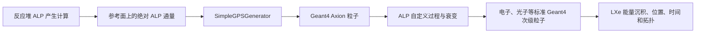

# RELICS 反应堆轴子 Geant4 模拟：代码与数据需求

更新日期：2026-08-08  
目标工程：`/home/liuwch/R10_v2_clean`（实现时可先在 `/home/liuwch/RelicsSim` 验证）

## 1. 结论与范围

目标是模拟反应堆产生的轴子/类轴子粒子（下文统称 ALP）进入 RELICS 几何后，在屏蔽体和液氙探测器中发生：

- inverse Primakoff 转换；
- inverse Compton-like 转换；
- axioelectric 吸收；
- 允许时的衰变；
- 视理论模型需要加入的电子对产生或弹性散射；
- 上述过程产生的电子、光子等次级粒子在 Geant4 标准物理过程中继续输运和沉积能量。

第一版**不需要新增 `AxionGenerator.cc/.hh`**。现有 `SimpleGPSGenerator` 已能读取二维能谱文件，并能定义平面源、方向和角锥。只要理论方给出探测器位置处或指定参考面上的一维 ALP 能谱，使用：

```text
/gps/particle axion
```

即可生成轴子。

只有出现以下任一情况时，才新增 `AxionGenerator.cc/.hh`：

- 能量与方向有关联，不能独立抽样；
- 要从三维反应堆堆芯功率分布逐点产生 ALP；
- 每个事件需要物理权重或产生道标签；
- 一个文件同时包含多个质量、产生道或耦合，需要联合抽样；
- 需要 importance sampling、分层抽样或强制相互作用。

核心工作不是 Generator，而是：

1. 定义并注册新粒子；
2. 实现 ALP 与材料作用的截面和末态；
3. 将过程注册到运行时实际使用的 physics list；
4. 保存 ALP 相互作用真值及其探测器响应。

反应堆 ALP 文献通常考虑 Primakoff、Compton-like 和核跃迁产生；探测端考虑 inverse Primakoff、inverse Compton-like、axioelectric 吸收以及衰变。参考：[Axionlike particles searches in reactor experiments](https://arxiv.org/abs/2010.15712)。

## 2. 推荐的模拟边界

建议把“反应堆产生”和“RELICS 内输运”分开：



推荐输入是“到达 RELICS 外部参考面”的 ALP 通量。如果理论方给的是堆芯产生率，则还需要基线、立体角、衰变存活率和中间材料衰减；必须说明这些因素是否已包含，防止重复计算。

### 2.1 `260408_dp_v2.pdf` 中可迁移的信息

该 PDF 研究的是**暗光子（DP）**，不是轴子。DP 的动量混合、`epsilon^2` 截面缩放、介质振荡和衰变假设不能直接用于 ALP；但其蒙特卡洛抽样框架可以迁移：

- 多个物理过程竞争时，过程选择概率为 `sigma_i / sigma_total`；
- 粒子在均匀材料中的自由程服从 `n sigma exp(-n sigma l)`；
- 二体末态可按归一化微分截面 `(1/sigma) d sigma / dEr` 抽样 recoil；
- 抽样散射角后，要把局部坐标方向旋转到入射粒子的全局方向；
- 转换产生的 gamma 应继续进行标准 Compton、photoelectric 和 pair-production 输运，从而自然产生多簇信号。

这些功能在 Geant4 中应分别由 `GetMeanFreePath()`、`PostStepDoIt()`、过程竞争和标准 EM physics 实现，不应在外部脚本中手工循环 photon cascade。

PDF 的以下做法**不能直接照搬**：

1. 它把第一次相互作用强制放在原点，并假设无限大液氙；真实 RELICS 必须从源面输运并由几何边界决定是否相互作用或逃逸。
2. 它用 `rho(E) proportional Phi(E) sigma_total(E)` 抽样“已发生相互作用的条件样本”。若在完整 Geant4 中又按真实截面输运，会重复施加截面选择偏差。第一版应按 `Phi(E)` 发射；若以后使用强制相互作用，必须保存并应用 importance weight。
3. 它把吸收和 pair production 的全部入射能量当作当地沉积；在有限 RELICS 中，应显式生成电子、正电子和 gamma，让 Geant4 继续追踪，只有未显式追踪的原子退激发能才可记为 local deposit。
4. DP 的 `sigma_DP = epsilon^2 sigma_gamma` 不是普适 ALP 公式。ALP axioelectric、pair production 和 conversion 必须使用对应 ALP 拉氏量推导的截面与质量修正。
5. `m_DP < 2m_e` 时把衰变宽度设为零是 DP 模型假设；ALP 即使低于电子对阈值，只要 `g_agamma` 非零仍可有 `a -> gamma gamma`。

因此，本 PDF 对轴子项目最重要的新增要求是：Compton-like conversion 不仅要索取总截面和 `d sigma/d cos(theta)`，还应优先索取 `d sigma/dEr`、运动学上下限和 benchmark CDF。

### 2.2 两阶段实施原则

本项目按以下顺序推进，不在第一步同时解决反应堆通量、完整几何和所有作用过程。

#### 阶段 S：简化模拟（Axion + 纯 LXe + 物理过程）

目标是验证新粒子、截面、自由程和末态抽样本身正确。只使用真空 World 和一个均匀 LXe 体，不加入 RELICS 内部结构、铅屏蔽或反应堆绝对归一化。

推荐步骤：

1. **S0 - 粒子与自由输运**：注册 Axion；单能轴子穿过 LXe；暂不启用任何 ALP 作用过程。
2. **S1 - 单一过程**：优先实现 `a + e -> gamma + e`，因为它是二体末态，能同时验证 recoil、出射 gamma 和后续多簇。若理论方先提供其他完整截面，也可先做 inverse Primakoff 或 axioelectric。
3. **S2 - 过程逐项加入**：分别验证 inverse Primakoff、axioelectric 和 decay；每次只开一个过程，再做过程竞争。
4. **S3 - 简化谱验证**：在单能 benchmark 通过后，再读取 GPS 两列能谱；此时仍不要求绝对反应堆通量。

简化阶段新增文件：

```text
config/axion_lxe_test.xml
macro/axion_lxe_test.mac
analysis/axion_lxe_validation.py
```

`config/axion_lxe_test.xml` 可复用现有 `World` 和 `Cylinder`/简单体积类构造 LXe，不必另写 detector C++。`macro/axion_lxe_test.mac` 第一轮使用固定动能；`analysis/axion_lxe_validation.py` 对照 `1/(n sigma)`、`sigma_i/sigma_total`、微分截面 CDF 和四动量守恒。

真实耦合可能导致简化几何中几乎无相互作用。允许在**验证专用运行**中使用放大的参考耦合、放大的截面或强制首次相互作用，但必须保存权重并与物理率运行分开命名。

#### 阶段 R：应用到完整 RELICS

只有阶段 S 的单过程和竞争过程验证全部通过后，才进入完整 `R10_v2_clean` 几何。

RELICS 束流以现有 `macro/gammaBeam_source2.mac` 为模板，新建：

```text
macro/axionBeam_source2.mac
```

保留 source2 的几何与方向：

- 平面圆源中心 `(200, 0, -7.55) cm`；
- 半径 `8 cm`；
- `rot1 = (0,0,1)`、`rot2 = (0,-1,0)`，极轴指向 `-x`；
- `0-0.1 deg` 窄锥，近似平行束；
- 保持 `/gps/ang/type iso`，以兼容 Arb 能谱。

只将粒子和能谱环境变量改为：

```text
/gps/particle axion
/control/getEnv AXIONHIST
/gps/hist/file {AXIONHIST}
```

不要直接改写 `gammaBeam_source2.mac`，以便 gamma 与 axion 使用同一几何条件做对照。RELICS 阶段再加入真实反应堆谱、绝对通量、全部启用材料、屏蔽体转换、探测效率和 fiducial/veto cuts。

## 3. 必须新增或修改的代码文件

### 3.1 粒子定义

#### `user/mc/relics/Axion.hh`

声明派生自 `G4ParticleDefinition` 的单例粒子类，并提供 `Definition(mass)` 等静态入口。

#### `user/mc/relics/Axion.cc`

设置名称、质量、电荷、自旋、宇称、C 宇称、particle type/subtype、唯一编码、稳定性、寿命和 decay table。不同质量点建议分开运行，不能在 Geant4 初始化后修改质量。

粒子定义可参考服务器 Geant4 11.1.1 自带的：

```text
/opt/geant4-v11.1.1/share/Geant4/examples/extended/
exoticphysics/monopole/include/G4Monopole.hh
/opt/geant4-v11.1.1/share/Geant4/examples/extended/
exoticphysics/monopole/src/G4Monopole.cc
```

参考：[Geant4 particle documentation](https://geant4.web.cern.ch/documentation/pipelines/master/bfad_html/ForApplicationDevelopers/TrackingAndPhysics/particle.html)。

### 3.2 共享截面和运动学工具

#### `user/mc/relics/AxionCrossSectionData.hh/.cc`

统一完成：

- TXT/TSV/HDF5 数据读取；
- 按质量、总能量、元素和过程插值；
- 总截面、微分截面和 CDF 查询；
- 参考耦合缩放；
- 表格范围、单位和非负性检查；
- 微分截面积分与总截面一致性检查；
- 禁止越界静默外推。

#### `user/mc/relics/AxionKinematics.hh/.cc`

集中实现二体/三体末态运动学、recoil-energy 与 scattering-angle 转换、局部方向到全局方向的旋转，以及逐事件四动量守恒检查。

### 3.3 自定义物理过程

稀有离散过程建议派生自 `G4VDiscreteProcess`，至少实现 `IsApplicable()`、`GetMeanFreePath()` 和 `PostStepDoIt()`，并通过 `G4PhysicsListHelper::RegisterProcess()` 注册。参考：[How to Specify Physics Processes](https://geant4.web.cern.ch/documentation/dev/bfad_html/ForApplicationDevelopers/GettingStarted/physicsDef.html)。

#### `AxionInversePrimakoffProcess.hh/.cc`（必需）

模拟 `a + atom/nucleus -> gamma + atom/nucleus`。用元素相关的 atomic form factor 和微分截面抽样出射 gamma，处理 recoil，并终止入射 ALP。液氙中的低动量转移对原子结构敏感，不能只用裸核 `Z^2`。参考：[Atomic form factors and inverse Primakoff scattering of axion](https://doi.org/10.1016/j.physletb.2021.136174)。

#### `AxionComptonConversionProcess.hh/.cc`（必需）

模拟 `a + e -> gamma + e`。优先按 `d sigma/dEr` 抽样电子 recoil，再由二体运动学得到 photon 能量和角度；也可使用等价的 `d sigma/d cos(theta)`。生成 recoil electron 和 gamma，由 Geant4 继续输运。

若 `g_agamma` 和 `g_ae` 同时非零，同一末态可能包含 inverse Primakoff-like、inverse Compton 和干涉项；不能简单把两个独立截面相加。参考：[Direct detections of the axionlike particle revisited](https://doi.org/10.1103/PhysRevD.109.075044)。

#### `AxionAxioElectricProcess.hh/.cc`（必需）

模拟 `a + atom -> e + ionized atom`。ALP 被吸收，生成主电子；精确版本应抽样壳层并处理荧光 X 射线与 Auger 电子。只给总截面时，第一版只能做近似总能量响应，不能可靠预测多簇结构。

#### `AxionDecayPhysics.hh/.cc`（条件必需）

至少支持 `a -> gamma gamma`，并在 `m_a > 2m_e` 且模型允许时支持 `a -> e+ e-`。也可直接在 `Axion.cc` 创建 `G4DecayTable` 并使用现有 `G4DecayPhysics`。

#### `AxionPairProductionProcess.hh/.cc`（可选）

若理论范围包含 `a + Z -> e+ e- + Z` 或电子场三体末态，则需要足够的微分信息或预生成末态，不能只靠总截面。

#### `AxionElasticScatteringProcess.hh/.cc`（可选）

仅在理论模型明确含有 `a + e/Z -> a + e/Z` 且 recoil 可见时加入，并与转换成 photon 的过程严格区分。

### 3.4 Physics constructor 和完整 physics list

#### `user/mc/relics/AxionPhysics.hh/.cc`

派生自 `G4VPhysicsConstructor`；在 `ConstructParticle()` 中调用 `Axion::Definition(mass)`，在 `ConstructProcess()` 中注册启用的过程。参考：[Geant4 modular physics list](https://geant4.web.cern.ch/documentation/pipelines/master/bfad_html/ForApplicationDevelopers/UserActions/mandatoryActions.html)。

#### `user/mc/relics/RelicsAxionPhysics.hh/.cc`

派生自 `BambooPhysics`，复制当前 `PandaXPhysics` 的标准 physics constructors，再增加 `RegisterPhysics(new AxionPhysics(...))`，并通过 `PhysicsRegister` 注册为 `RelicsAxionPhysics`。

当前非光学运行实际选择 `PandaXPhysics`，所以只修改 `RelicsOpticalPhysics` 不会生效。独立 physics list 还能避免影响普通 gamma、neutron 和背景模拟。

### 3.5 源配置

#### `macro/axion_lxe_test.mac`（简化 S0-S3）

使用靠近纯 LXe 体的简单平面源。S0-S2 首先用 `/gps/energy <value> MeV` 固定动能；S3 再切换为 Arb 能谱。这个宏不负责模拟反应堆基线，只用于验证粒子和过程。

#### `macro/axionBeam_source2.mac`（RELICS R1-R3）

复制 `macro/gammaBeam_source2.mac`，保留其 `(200,0,-7.55) cm` 平面、`8 cm` 半径和 `0-0.1 deg` 近平行 `-x` 束流。不要修改原 gamma 宏。轴子版本的核心差异为：

```text
/gps/particle axion
/gps/ene/type Arb
/gps/ene/diffspec 1
/gps/hist/type arb
/control/getEnv AXIONHIST
/gps/hist/file {AXIONHIST}
/gps/hist/inter Lin
```

Geant4 GPS 对有质量粒子读取的是**动能**。若理论谱给的是总能量，必须先转换 `T_a = E_a - m_a`。

#### `user/mc/relics/AxionGenerator.hh/.cc`（条件可选）

第一版不新增；只在存在联合分布、事件权重、堆芯三维产生或强制相互作用时实现。

### 3.6 构建和配置

- 修改 `user/mc/relics/sources.cmake`，加入所有新增 `.cc`；
- 修改 `scripts/relics_xml.py`，新增 `gen == "axion"`；
- 新增 `config/axion_model_reference.yaml`，保存质量、耦合、过程开关和数据路径；
- 生成 XML 时选择 `RelicsAxionPhysics` 与 `SimpleGPSGenerator`；
- 重新运行 CMake 配置和编译。

### 3.7 真值输出和分析

需要修改：

```text
src/PandaXSteppingAction.cc
include/PandaXDataManager.hh
src/PandaXDataManager.cc
Multi/energy/dtypes.py
Multi/energy/Sorting.py
```

应保存 process name、volume、位置、时间、入射/出射四动量、track/parent ID、次级粒子和 local deposit。

新增：

```text
analysis/axion_transport_analysis.ipynb
```

至少分析入射能谱、过程占比、相互作用体积、可见能量、单簇/多簇、首次/全部相互作用、次级 gamma 距离和角度，以及绝对事件率。

## 4. 必须向理论/截面计算人员索取的数据

本节使用以下阶段标记：

- **S1/S2**：纯 LXe 简化模拟中的单过程/多过程验证；
- **S3**：纯 LXe 简化模拟中的能谱输入验证；
- **R1**：`axionBeam_source2.mac` 接入完整 RELICS，但暂不做绝对率；
- **R2**：完整材料和屏蔽体输运；
- **R3**：绝对事件率与探测器响应。

下面的文件总表描述了 Geant4 运行时最终需要具备的物理信息和可落盘缓存。**当前首选交付方式不是让理论方逐质量、逐能量生成全部表格，而是按 9.1 节提供 Mathematica 权威版本、Python 冻结接口和少量 benchmark；表中的大部分 TSV/CDF 由本项目调用理论接口后自行生成。**只有理论方无法提供可运行代码时，才按 9.2 节直接索取表格。

因此，表中“理论方提供”应理解为“理论方对该物理量负责”：可以直接提供数据，也可以提供能计算该物理量的公式/代码。标为“本项目生成”的文件始终由项目侧转换得到。

| 文件 | 格式 | 用途 | 使用步骤 | 来源 |
|---|---|---|---|---|
| `data/axion/model/axion_model_metadata.yaml` | YAML，带字段名和单位 | 固定拉氏量、质量、耦合定义、参考耦合和缩放规则 | S1-S3、R1-R3 | 理论方提供 |
| `data/axion/source/reactor_axion_flux.tsv` | TSV；总能量与绝对微分通量 | 反应堆 ALP 总谱及各产生道归一化 | R1、R3；S3 可只取谱形 | 理论方提供 |
| `data/axion/source/reactor_axion_lines.tsv` | TSV；一行一个核跃迁谱线 | 保存核跃迁产生的离散 ALP 线 | R1、R3；仅核跃迁显著时 | 理论方提供 |
| `data/axion/source/source_normalization.yaml` | YAML | 热功率、基线、积分通量、参考面、存活率和屏蔽修正 | R3 | 理论方/实验方共同提供 |
| `data/axion/source/gps_axion_spectrum_ma_<mass>.txt` | 无表头两列 TXT；动能、权重 | 供 GPS Arb 直接抽样 | S3、R1-R3 | 本项目由 flux TSV 生成 |
| `data/axion/source/source_geometry.yaml` | YAML | 定义堆芯、RELICS、参考面和坐标系；核对 source2 | R1-R3 | 实验方提供/本项目整理 |
| `data/axion/source/reactor_axion_flux_E_costheta.tsv` | TSV；`m_a,E_a,cosθ,d²Phi` | 能量-方向联合分布；决定是否需要 AxionGenerator | R1-R3，可选 | 理论方提供 |
| `data/axion/source/reactor_core_profile.tsv` | TSV；空间点和相对功率密度 | 从堆芯体积直接产生 ALP | R1-R3，可选 | 反应堆/理论方提供 |
| `data/axion/xsec/inverse_primakoff/Xe_total.tsv` | TSV；总截面 | LXe 中 inverse Primakoff 平均自由程 | S1/S2、R1-R3 | 理论方提供 |
| `data/axion/xsec/inverse_primakoff/Xe_dcos.tsv` | TSV；角微分截面 | 抽样出射 gamma 角度与 recoil | S1/S2、R1-R3 | 理论方提供 |
| `data/axion/form_factor/Xe_atomic_form_factor.tsv` | TSV；`q,F(q)` | 若截面公式在代码中计算，用于 Xe 原子屏蔽 | S1/S2、R1-R3 | 理论方提供 |
| `data/axion/xsec/inverse_primakoff/<element>_total.tsv` | 每元素一个 TSV | 完整材料中的 inverse Primakoff 自由程 | R2-R3 | 理论方提供 |
| `data/axion/xsec/inverse_primakoff/<element>_dcos.tsv` | 每元素一个 TSV | 完整材料中的转换角分布 | R2-R3 | 理论方提供 |
| `data/axion/form_factor/<element>_atomic_form_factor.tsv` | 每元素一个 TSV | 完整材料的原子屏蔽/form factor | R2-R3 | 理论方提供 |
| `data/axion/xsec/compton_conversion/total.tsv` | TSV；每 electron 总截面 | `a+e->gamma+e` 平均自由程 | S1-S3、R1-R3 | 理论方提供 |
| `data/axion/xsec/compton_conversion/dEr.tsv` | TSV；`dσ/dEr` | 抽样电子 recoil 和出射 gamma | S1-S3、R1-R3 | 理论方提供 |
| `data/axion/xsec/compton_conversion/dcos.tsv` | TSV；`dσ/dcosθ` | 角分布交叉验证或替代抽样 | S1/S2、R1-R3，可选但推荐 | 理论方提供 |
| `data/axion/xsec/compton_conversion/benchmark_cdf.tsv` | TSV；`E_r,CDF` | 单元测试 inverse-transform sampling | S1 | 理论方提供 |
| `data/axion/xsec/a_e_to_gamma_e/combined_dEr.tsv` | TSV；三个耦合项的 recoil 微分截面 | 同时开启 `g_aγ`、`g_ae` 时包含干涉 | S2、R1-R3 | 理论方提供 |
| `data/axion/xsec/a_e_to_gamma_e/combined_dcos.tsv` | TSV；三个耦合项的角微分截面 | 干涉角分布验证 | S2、R1-R3，可选但推荐 | 理论方提供 |
| `data/axion/xsec/axioelectric/Xe_total.tsv` | TSV；每 atom 总截面 | LXe axioelectric 吸收 | S2、R1-R3 | 理论方提供 |
| `data/axion/xsec/axioelectric/Xe_shells.tsv` | TSV；壳层 partial cross sections | Xe 壳层、X ray/Auger 与多簇 | S2、R1-R3，精确响应时 | 理论方提供 |
| `data/axion/xsec/axioelectric/<element>_total.tsv` | 每元素一个 TSV | 完整材料中的 axioelectric 吸收 | R2-R3 | 理论方提供 |
| `data/axion/xsec/axioelectric/<element>_shells.tsv` | 每元素一个 TSV | 完整材料原子退激发 | R2-R3，可选 | 理论方提供 |
| `data/axion/decay/axion_decay_widths.tsv` | TSV；宽度、寿命、分支比 | 验证 `a->γγ/e+e-` 和飞行存活率 | S2、R1-R3 | 理论方提供 |
| `data/axion/xsec/pair_production/<element>_total.tsv` | 每元素一个 TSV | 可选 ALP 场致电子对产生率 | S2 先用 Xe；R2-R3 扩展 | 理论方提供 |
| `data/axion/xsec/pair_production/<element>_final_state.h5` | HDF5；三体末态四动量和权重 | 抽样不可由一维角度描述的三体末态 | S2 先用 Xe；R2-R3 扩展 | 理论方提供 |
| `data/axion/xsec/elastic/<element>_total.tsv` | 每元素一个 TSV | 可选弹性散射自由程 | S2 先用 Xe；R2-R3 扩展 | 理论方提供 |
| `data/axion/xsec/elastic/<element>_dcos.tsv` | 每元素一个 TSV | 可选弹性 recoil/角分布 | S2 先用 Xe；R2-R3 扩展 | 理论方提供 |
| `data/axion/validation/benchmark_points.tsv` | TSV；离散参数点与理论结果 | 总截面、均值、率和运动学回归测试 | S1/S2、R3 | 理论方提供 |

**当前最小启动交付包**为：模型 YAML、`reactor_spectrum.py`、包含一个 Xe 单过程的 `interactions.py`、Mathematica 高精度 `benchmark_points.tsv`、自动测试和 README。单过程总截面、微分截面和 CDF 缓存由本项目生成。反应堆绝对通量、全材料截面和 source2 绝对归一化当前不索取。

### 4.1 模型定义和耦合约定

必须先拿到一份机器可读或明确书面定义，至少包括：

- ALP 是 scalar 还是 pseudoscalar；
- 采用的相互作用拉氏量；
- `g_aγ`、`g_ae`、`g_an^(0)`、`g_an^(1)` 的定义和单位；
- 是否包含导数型或非导数型电子耦合；
- 截面表是否已经乘入耦合；
- 表对应的参考耦合；
- 截面随耦合的缩放幂次；
- 同时非零的耦合之间是否存在干涉；
- 质量和能量的有效范围；
- 使用的原子屏蔽、nuclear/atomic form factor；
- 近似条件，例如自由电子、静止原子、忽略反冲等。

建议文件：

```text
data/axion/model/axion_model_metadata.yaml
```

没有这些信息，即使拿到数值表也无法可靠缩放到不同参数点。

### 4.2 反应堆 ALP 绝对能谱

首选格式：

```text
data/axion/source/reactor_axion_flux.tsv
```

列定义：

```text
# ma_MeV  Ea_total_MeV  dPhi_dEa_cm-2_s-1_MeV-1  channel
0.100     1.000   1.234e+08                 primakoff
0.100     1.010   1.218e+08                 primakoff
```

必须说明：

- 是堆芯产生谱、离开反应堆后的谱，还是 RELICS 参考面处的谱；
- 是否已经包含 `1/(4πL²)`；
- 基线 `L`；
- 反应堆热功率；
- 参考耦合；
- 是否已经包含从堆芯到探测器的衰变存活率；
- 是否已经包含屏蔽体中的吸收/转换；
- 是全立体角通量还是朝向探测器的通量；
- 是总能量还是动能；
- bin 值是 bin center、bin edge 还是 bin-integrated yield；
- 能谱积分后的总通量。

产生道应尽可能分别提供：

```text
primakoff
compton_like
nuclear_transition
bremsstrahlung
other
```

如果核跃迁产生显著，应额外提供：

```text
data/axion/source/reactor_axion_lines.tsv
```

列定义：

```text
# isotope  transition  Ea_total_MeV  line_flux_cm-2_s-1  width_MeV  reference_coupling
```

### 4.3 GPS 可直接读取的能谱

由规范化总谱转换生成：

```text
data/axion/source/gps_axion_spectrum_ma_<mass>.txt
```

格式必须无表头、两列、按能量递增：

```text
1.000000e-03  2.345000e-06
1.010000e-03  2.418000e-06
```

定义：

- 第一列：`Ta_kinetic_MeV = Ea_total_MeV - ma_MeV`；
- 第二列：非负微分谱权重；
- 无 NaN、负数、重复能量点；
- 文件只决定抽样形状，绝对通量放在 metadata 中；
- 每个 ALP 质量最好单独一个文件。

Geant4 GPS 的粒子能量是**动能**，而理论计算通常把 `E_a` 定义为总能量。对有质量 ALP，不能把理论表的总能量列原样交给 GPS；预处理时必须减去 `m_a`。由于 `dE_a/dT_a = 1`，谱密度的数值不需额外 Jacobian，但阈值必须满足 `E_a >= m_a`。

当前 R10 反应堆 gamma 谱约覆盖 1–8 MeV，但 ALP 表应覆盖实际产生谱。建议理论输入覆盖从阈值到至少 10 MeV，并在谱线和作用阈值附近加密；不要在有效区间外静默外推。

### 4.4 源方向和空间信息

若使用平行束/小角锥，只需：

```text
data/axion/source/source_geometry.yaml
```

包含：

- reactor core center；
- RELICS detector center；
- 坐标系定义；
- baseline；
- core dimensions；
- reference plane center/radius；
- 源轴方向；
- 束流角范围；
- 生成面积。

如果理论方认为能量和角度相关，索取：

```text
data/axion/source/reactor_axion_flux_E_costheta.tsv
```

列定义：

```text
# ma_MeV  Ea_total_MeV  cos_theta  d2Phi_dEa_dcostheta_cm-2_s-1_MeV-1
```

出现这种联合分布时才新增 `AxionGenerator.cc/.hh`。

若必须从堆芯内部产生，还要：

```text
data/axion/source/reactor_core_profile.tsv
```

列定义建议为：

```text
# x_cm  y_cm  z_cm  relative_power_density  material_or_region
```

### 4.5 Inverse Primakoff 数据

必须获得“总截面 + 微分截面”，或者获得可直接实现并经过验证的解析公式。

#### 总截面

```text
data/axion/xsec/inverse_primakoff/<element>_total.tsv
```

列定义：

```text
# ma_MeV  Ea_total_MeV  sigma_cm2_per_atom
```

#### 微分截面

```text
data/axion/xsec/inverse_primakoff/<element>_dcos.tsv
```

列定义：

```text
# ma_MeV  Ea_total_MeV  cos_theta_gamma  dsigma_dcostheta_cm2_per_atom
```

#### 原子 form factor

若不是直接提供微分截面，则必须提供：

```text
data/axion/form_factor/<element>_atomic_form_factor.tsv
```

列定义：

```text
# q_MeV  F_dimensionless  convention
```

必须说明：

- `q` 是三动量转移还是四动量转移；
- `F(0)` 的归一化；
- 是否已含 Z；
- 是否含电子屏蔽；
- 是否含非弹性原子通道；
- 截面是每 atom、每 nucleus 还是每 kg。

### 4.6 Inverse Compton-like 和干涉数据

如果只开 `g_ae`，索取：

```text
data/axion/xsec/compton_conversion/total.tsv
data/axion/xsec/compton_conversion/dEr.tsv
data/axion/xsec/compton_conversion/dcos.tsv
```

总截面列：

```text
# ma_MeV  Ea_total_MeV  sigma_cm2_per_electron
```

优先提供 recoil-energy 微分截面：

```text
# ma_MeV  Ea_total_MeV  Er_electron_MeV
# dsigma_dEr_cm2_per_electron_per_MeV
```

同时提供每个 `(ma, Ea)` 的 `Er_min`、`Er_max`。也可提供等价的角分布：

```text
# ma_MeV  Ea_total_MeV  cos_theta_gamma
# dsigma_dcostheta_cm2_per_electron
```

推荐另给若干 benchmark CDF：

```text
data/axion/xsec/compton_conversion/benchmark_cdf.tsv
# ma_MeV  Ea_total_MeV  Er_electron_MeV  cdf
```

代码验证时应确认 `d sigma/dEr` 积分等于总截面，并由 `E_gamma = E_a - E_r` 与完整二体运动学重建出射角。这里的 `E_r` 必须明确是电子 recoil，不应沿用 PDF 中把它误写为 photon recoil 的文字表述。

如果 `g_aγ` 与 `g_ae` 同时非零，应优先索取包含干涉的组合表：

```text
data/axion/xsec/a_e_to_gamma_e/combined_dcos.tsv
data/axion/xsec/a_e_to_gamma_e/combined_dEr.tsv
```

列定义：

```text
# ma_MeV  Ea_total_MeV  cos_theta_gamma_or_Er_MeV
# term_agamma2_cm2  term_gae2_cm2  term_interference_cm2
```

并给出如何从参考耦合缩放三个项。必须确认积分后的组合总截面始终非负。

### 4.7 Axioelectric 数据

最低要求：

```text
data/axion/xsec/axioelectric/<element>_total.tsv
```

列定义：

```text
# ma_MeV  Ea_total_MeV  sigma_cm2_per_atom
```

为了模拟多簇和原子退激发，推荐同时索取：

```text
data/axion/xsec/axioelectric/<element>_shells.tsv
```

列定义：

```text
# ma_MeV  Ea_total_MeV  shell_id  binding_energy_keV
# partial_sigma_cm2_per_atom
```

若理论计算使用 photoelectric 截面的比例关系，必须说明：

- 所用 photoelectric 数据库；
- 公式和适用能区；
- 是否按壳层计算；
- 相对论和原子修正；
- 参考 `g_ae`。

### 4.8 衰变数据

至少提供公式和参考实现；推荐提供验证表：

```text
data/axion/decay/axion_decay_widths.tsv
```

列定义：

```text
# ma_MeV  g_agamma_GeV-1  g_ae
# width_gg_MeV  width_ee_MeV  total_width_MeV
# lifetime_s  br_gg  br_ee
```

必须明确：

- `a -> gamma gamma` 的宽度约定；
- `a -> e+ e-` 阈值和宽度；
- 其他不可见衰变是否存在；
- 通量文件是否已乘入从反应堆到探测器的衰变存活率。

### 4.9 可选的电子对产生或弹性散射数据

若要启用，至少索取：

```text
data/axion/xsec/pair_production/<element>_total.tsv
data/axion/xsec/pair_production/<element>_final_state.h5
data/axion/xsec/elastic/<element>_total.tsv
data/axion/xsec/elastic/<element>_dcos.tsv
```

三体末态不建议只用二维 TXT。推荐 HDF5 保存预生成的无权或带权末态：

```text
ma_MeV
Ea_total_MeV
weight
electron_px_MeV
electron_py_MeV
electron_pz_MeV
positron_px_MeV
positron_py_MeV
positron_pz_MeV
recoil_px_MeV
recoil_py_MeV
recoil_pz_MeV
```

### 4.10 必须覆盖的元素

当前 `R10_v2_clean/config/cevns_clean.xml` 直接使用：

- LXe：Xe；
- Teflon：C、F；
- Copper：Cu；
- SS304LSteel：Fe、Cr、Ni、Mn、Si。

若把铅屏蔽、空气和完整 RELICS 几何也纳入 ALP 输运，还应覆盖：

- Pb；
- H、C、N、O、Ar；
- Al、Si、Ca；
- 几何中实际启用的其他元素。

理论方若提供的是可按 `Z`、`A` 和原子 form factor 计算的通用代码，则不必逐元素交付总截面表，但仍需要每个元素的 form factor 或明确的屏蔽模型。

## 5. 数据文件统一规范

所有 TXT/TSV 文件要求：

- UTF-8 或纯 ASCII；
- 注释行以 `#` 开头；
- 数据区不允许单位字符串；
- 科学计数法；
- 能量单调递增；
- 明确 bin center/edge/integral；
- 不允许缺失值、NaN、inf；
- 记录数据版本、生成代码 commit、论文/公式来源；
- 总截面和微分截面的单位必须写在列名；
- 每个表给出适用的质量、能量和耦合范围；
- 超出表格范围时禁止默认常数外推。

推荐每组数据同时提供：

```text
README.md
metadata.yaml
*.tsv
validation_points.tsv
```

`validation_points.tsv` 至少给出若干人工可核对的质量、能量、耦合、总截面和平均出射能量。

## 6. 绝对事件率归一化所需信息

仅有归一化到 1 的 GPS 能谱无法计算预期事件数。必须同时获得：

- 参考面处积分 ALP 通量，单位 `cm^-2 s^-1`；
- 反应堆热功率和运行状态；
- 堆芯到参考面的距离；
- 生成平面面积；
- 每个源文件的参考质量和耦合；
- 各产生道的通量；
- decay survival；
- 屏蔽衰减是否已包含；
- 模拟事件数；
- 过程截面的参考耦合和缩放；
- RELICS exposure、live time 和 fiducial mass。

建议保存为：

```text
data/axion/source/source_normalization.yaml
```

最终物理事件率应独立用薄靶近似交叉验证：

```text
rate ≈ flux × number_of_targets × cross_section × efficiency
```

## 7. 推荐实施顺序

严格按以下 gate 推进；前一步未通过，不进入下一步。

### S0：纯 LXe 中的 Axion 自由输运

代码：

- `Axion.hh/.cc`；
- `AxionPhysics.hh/.cc`；
- `RelicsAxionPhysics.hh/.cc`；
- `config/axion_lxe_test.xml`；
- `macro/axion_lxe_test.mac`。

输入数据：只需 `axion_model_metadata.yaml` 中的一个质量点；宏使用固定动能，不需要反应堆谱或截面文件。

通过条件：粒子表中存在 `axion`；质量和 GPS 动能正确；Axion 只做 transportation；零耦合无沉积。

### S1：纯 LXe 中的第一个物理过程

推荐先做 `a+e->gamma+e`。只启用一个过程，使用：

```text
compton_conversion/total.tsv
compton_conversion/dEr.tsv
compton_conversion/benchmark_cdf.tsv
validation/benchmark_points.tsv
```

通过条件：平均自由程等于 `1/(n_e sigma)`；recoil CDF 一致；四动量守恒；electron 和 gamma 由 Geant4 继续输运；有限 LXe 中允许逃逸。

### S2：纯 LXe 中逐项加入其他过程

顺序建议：

1. inverse Primakoff；
2. axioelectric；
3. `a->gamma gamma`，以及运动学允许时的 `a->e+e-`；
4. 可选 pair production/elastic；
5. 多过程 competition 和 `g_agamma-g_ae` 干涉。

本阶段只要求 Xe 数据。通过条件：每个单过程 benchmark 通过；多过程比例与 `sigma_i/sigma_total` 一致；无重复计数。

### S3：纯 LXe 中加入一维 ALP 能谱

从 `reactor_axion_flux.tsv` 选择一个质量点并生成：

```text
gps_axion_spectrum_ma_<mass>.txt
```

这里只验证谱形、总能量到动能的转换和能量依赖截面；不计算最终 RELICS 绝对事件率。若只为调试，也可使用理论方给出的归一化谱形子集。

### R1：用 source2 束流接入完整 RELICS

复制而不是修改：

```text
macro/gammaBeam_source2.mac
    -> macro/axionBeam_source2.mac
```

使用 source2 的 `x=200 cm`、`z=-7.55 cm`、`r=8 cm` 和 `0-0.1 deg` 近平行 `-x` 束流。先只允许 ALP 过程作用于 Xe，验证：

- `primaryPx` 均值为负；
- 能谱与 GPS 输入一致；
- source2 几何接受度；
- LXe 中的过程结果与 S 阶段一致。

### R2：完整材料和屏蔽体输运

加入 Xe 以外的 C、F、Cu、Fe、Cr、Ni、Mn、Si、Pb 等实际启用元素数据。检查 ALP 在屏蔽体中的吸收/转换，以及屏蔽体产生的 secondary gamma 是否进入 TPC。

如果目标只是“ALP 到达 LXe 后的信号”，可先明确禁止 ALP 在非 Xe 材料中作用，将 R2 延后；但文档和输出中必须标明这一近似。

### R3：绝对率和探测器响应

最后才加入：

- `source_normalization.yaml` 中的热功率、基线和积分通量；
- decay survival 和屏蔽修正；
- exposure、fiducial mass 和 live time；
- 阈值、能量/位置分辨、簇合并、veto 和 fiducial cuts；
- 单簇、多簇、双步距离与角度分布。

最终结果必须同时给出未经探测器效应的 truth rate 和经过选择后的 detected rate。

## 8. 必须完成的验证

- `/particle/list` 中能找到 `axion`；
- 零耦合时 ALP 只输运、不相互作用；
- `GetMeanFreePath()` 与 `1/(nσ)` 一致；
- 微分截面积分与总截面一致；
- `dσ/dEr` 生成的数值 CDF 与理论方 benchmark CDF 一致；
- 单一材料中各过程占比与 `σ_i/σ_total` 一致；
- 均匀无限介质的自由程分布与 `nσ exp(-nσl)` 一致；
- 每个过程逐事件四动量守恒；
- 转换过程正确杀死 ALP 并生成次级粒子；
- axioelectric 可见能与理论一致；
- decay length 与 `βγcτ` 一致；
- 事件率按耦合预期幂次缩放；
- 改变材料厚度时满足薄靶线性关系；
- 组合过程不存在重复计算；
- 同一参数点能复现理论方给出的 benchmark rate；
- 作为单独验证模式，强制首次相互作用的条件样本能复现 `260408_dp_v2.pdf` 所示抽样流程；该模式不得用于未经权重修正的真实率计算；
- 多线程运行结果与单线程统计相容。

## 9. 可以直接发给理论人员的数据请求

### 9.1 当前首选：理论代码交付包与冻结接口

下面内容可直接发给理论人员。当前采用“**理论方维护计算内核，模拟方只调用冻结接口**”的协作方式，不要求理论方为每个质量、能量和散射变量预先生成稠密大表。

模拟端环境为：

- Geant4 11.1.1；
- GCC 11.4，C++14；
- Python 3.10；
- NumPy、SciPy 可用；
- `relics3` 当前没有 Mathematica/Wolfram Engine。

Mathematica notebook 继续作为理论公式、高精度计算和 benchmark 的权威版本；另请提供经过 Mathematica 验证、可在 Python 3.10 下运行的数值接口。理论计算代码由理论方统一维护；模拟方不直接修改其内部公式，只编写外部调用、Geant4 封装和缓存生成程序。接口或计算有修改时，由理论方发布新版本并更新 benchmark，模拟方重新生成缓存。

当前范围：

1. **第一阶段 S0-S3**：Axion + 纯 LXe + 轴子物理过程，先单过程、再多过程，并使用反应堆轴子能谱形状生成事件；
2. **第二阶段 R1-R2 初版**：沿用 `macro/gammaBeam_source2.mac` 的参考面、束斑和方向建立 `macro/axionBeam_source2.mac`，接入完整 RELICS 几何；初版仍可只在 LXe 中开启轴子相互作用；
3. 当前不计算绝对通量、曝光量和预期事件数。要求谱形和不同产生道之间的相对比例正确，但不要求归一化。

#### 9.1.1 需要交付的文件

推荐目录：

```text
theory_axion_v1/
├── README.md                         # 安装、约定、公式和版本说明
├── axion_model_metadata.yaml         # 粒子、质量、耦合和有效范围
├── requirements.txt                  # Python 依赖及版本范围
├── reactor_spectrum.py               # 反应堆 ALP 连续谱形和线谱接口
├── interactions.py                   # 总截面、微分截面和运动学边界
├── atomic_response.py                # form factor、axioelectric 壳层响应
├── benchmark_points.tsv              # 少量Mathematica 高精度验证点
├── test_against_benchmarks.py        # 比较 Python 与 benchmark

```

各文件用途和使用步骤：

| 文件 | 主要内容与格式 | 用途 | 使用步骤 |
|---|---|---|---|
| `README.md` | Markdown；公式/论文来源、运行方法、单位、阈值、数值精度和已知限制 | 使理论代码可复现，防止接口歧义 | S0-S3、R1-R2 |
| `axion_model_metadata.yaml` | YAML；粒子类型、`ma`、拉氏量、耦合定义、参考耦合、有效范围 | 唯一确定模型约定，防止重复乘耦合 | S0-S3、R1-R2 |
| `requirements.txt` | pip requirements；固定或限定依赖版本 | 在独立 Python 环境中重建理论计算接口 | 预处理和验证 |
| `reactor_spectrum.py` | Python 3.10；返回连续谱相对权重和可选离散线 | 生成归一化到 1 的反应堆 ALP 入射谱形 | S3、R1-R2 |
| `interactions.py` | Python 3.10；总截面、一个规范微分截面、运动学边界和可选末态构造 | 生成 Geant4 过程所需截面/CDF 缓存
| `atomic_response.py` | Python 3.10；`F(Z,q)`、axioelectric 总截面或壳层比例 | Xe 原子响应；以后按需扩展到其他元素
| `benchmark_points.tsv` | UTF-8 TSV；少量 Mathematica 高精度参考点 | 验证 Python 转写、单位转换、积分和阈值行为 
| `test_against_benchmarks.py` | Python 3.10 自动测试 | 一条命令检查发布包是否达到声明精度 

如公式都能放在 `interactions.py` 中，`atomic_response.py` 可合并进去；文件名可以调整，但下述输入输出语义不能改变。

#### 9.1.2 公共输入约定

所有 Python 函数统一采用下列物理量：

| 输入 | 类型/单位 | 含义 |
|---|---|---|
| `process` | string | `compton_conversion`、`inverse_primakoff`、`axioelectric`、`elastic`、`pair_production` 等 |
| `ma_MeV` | float，MeV | ALP 静质量 |
| `Ea_total_MeV` | float，MeV | ALP **总能量**，必须满足 `Ea_total_MeV >= ma_MeV` |
| `g_agamma_GeV_inv` | float，GeV^-1 | photon coupling，定义写入 metadata |
| `g_ae` | float | electron coupling，量纲和拉氏量定义写入 metadata |
| `target` | string 或结构体 | `free_electron`、`Xe`，以后可扩展为 `Z`、`A` |
| `channel` | string | 反应堆产生道，例如 `primakoff`、`compton_like`、`nuclear_transition` |
| `t_MeV2` | float，MeV^2 | 选用 Mandelstam `t` 时的微分变量；符号约定写入 README |

统一规则：

- 理论接口输入 `Ea_total_MeV`；Geant4 GPS 所需动能由模拟方用 `Ta_kinetic_MeV = Ea_total_MeV - ma_MeV` 转换；
- 低于物理阈值返回精确 `0.0`；
- 超出有效质量或能量范围必须抛出明确错误，禁止静默常数外推；
- 必须说明截面是否已经乘入耦合，以及允许怎样从参考耦合缩放；
- 必须区分 `cm2/electron`、`cm2/atom` 和 `cm2/nucleus`；
- 函数应为确定性数值函数。复杂末态若需要随机数，必须把 `[0,1)` 的随机数作为显式输入，不得在理论函数内部使用不可控的全局随机源。

#### 9.1.3 反应堆能谱形状接口

`reactor_spectrum.py` 提供：

```python
def spectrum_shape(
    ma_MeV,
    Ea_total_MeV,
    g_agamma_GeV_inv,
    g_ae,
    channel,
):"""返回非负相对谱密度；不要求绝对通量单位。"""
```

可选的离散线接口：

```python
def line_spectrum(ma_MeV, g_agamma_GeV_inv, g_ae):
    """
    返回记录列表；每条包含：
    isotope, transition, Ea_total_MeV,
    relative_weight, width_MeV, channel
    """
```

输出要求：

- `spectrum_shape` 返回有限、非负浮点数；
- 说明是否包含核跃迁线、飞行衰变存活率以及任何会改变谱形的传播效应；

#### 9.1.4 相互作用接口

`interactions.py` 提供总截面：

```python
def sigma_total(
    process,
    ma_MeV,
    Ea_total_MeV,
    target,
    g_agamma_GeV_inv,
    g_ae,
):
    """返回总截面；电子过程用 cm2/electron，原子过程用 cm2/atom。"""
```

每个散射/转换过程只需提供一种完整的规范微分截面，使用：

```python
def dsigma_dt(
    process,
    ma_MeV,
    Ea_total_MeV,
    t_MeV2,
    target,
    g_agamma_GeV_inv,
    g_ae,
):
    """返回 d_sigma/d_t，单位 cm2/MeV2，并遵循 README 中的 t 符号约定。"""

def t_bounds(process, ma_MeV, Ea_total_MeV, target):
    """返回 (t_min_MeV2, t_max_MeV2)。"""
```

如果某过程使用 `cos_theta` 或 recoil energy 数值上更稳定，可以改为 `dsigma_dcostheta` 或 `dsigma_dEr`，但每个过程只指定一个主抽样变量，并同时给出范围和末态运动学转换。

二体过程建议提供：

```python
def final_state_from_variable(
    process,
    ma_MeV,
    Ea_total_MeV,
    variable_value,
    target,
):
    """返回末态粒子 PDG、能量和四动量，或给出等价的完整解析公式。"""
```

三体过程如 pair production 只有在当前模型和能区确实重要时才提供，优先提供显式随机数输入的末态抽样器，而不是为每个 `(ma,Ea)` 交付大型 HDF5 样本库。

#### 9.1.5 原子响应和衰变接口

Inverse Primakoff 如需单独 form factor：

```python
def atomic_form_factor(Z, q_MeV):
    """返回无量纲 F；README 说明 F(0)、是否已含 Z 和电子屏蔽。"""
```

Axioelectric：

```python
def axioelectric_total(ma_MeV, Ea_total_MeV, Z, g_ae):
    """返回 cm2/atom。"""

def axioelectric_shell_fractions(ma_MeV, Ea_total_MeV, Z):
    """可选；返回 shell_id、binding_energy_keV、relative_probability。"""
```

ALP 衰变：

```python
def decay_widths(ma_MeV, g_agamma_GeV_inv, g_ae):
    return {
        "gamma_gamma_MeV": value,
        "electron_positron_MeV": value,
    }
```

#### 9.1.6 Mathematica benchmark 的输入输出

`benchmark_points.tsv` 为 UTF-8 TSV，每行一个高精度参考量，列至少为：

```text
quantity
process
ma_MeV
Ea_total_MeV
target
variable
variable_value
expected_value
unit
g_agamma_GeV_inv
g_ae
mathematica_working_precision
estimated_relative_error
```

每个启用过程建议给 5-20 个点，覆盖阈值附近、低/中/高能区、至少两个质量点、总截面、若干微分截面值和一个积分/分布矩。能谱接口也应给若干连续谱值及离散线输出。benchmark 用于验证 Python 转写和 Geant4 预处理，不用于覆盖整个参数空间。

建议在 `README.md` 中声明：

- 普通区域及阈值附近分别可保证的误差；
- 是否存在严重抵消、积分尖峰、端点奇异性或需要特殊展开的区域；
- Python 实现相对 Mathematica benchmark 的允许误差；
- 超小截面是否需要同时返回 `log_sigma` 防止下溢。

#### 9.1.7 模拟方自行生成、不向理论方索取的文件

理论接口冻结后，以下运行文件由本项目针对实际质量和能区自动生成：

```text
data/axion/source/gps_axion_spectrum_ma_<mass>.txt
data/axion/cache/total_xsec_cache.tsv
data/axion/cache/differential_xsec_cache.tsv
data/axion/cache/cdf_cache.tsv
data/axion/cache/cache_metadata.yaml
```

GPS 文件为无表头两列：

```text
Ta_kinetic_MeV  relative_weight
```

缓存必须记录理论包版本、文件哈希、质量、能区、耦合、积分容差和生成时间。只要理论代码或 benchmark 更新，就使旧缓存失效并重新生成。

#### 9.1.8 当前暂不索取的信息

当前不计算绝对事件率，因此暂不索取：

- 反应堆热功率和总裂变率；
- 绝对 ALP 通量及积分通量；
- 曝光时间和探测器曝光量；
- `source_normalization.yaml`；
- `1/(4 pi L^2)` 的绝对归一化；
- source2 平面上的绝对粒子率；
- 每日/每年的预期事件数和背景率；
- 三维堆芯功率分布（采用 source2 参考面入射时）；
- 非 Xe 元素的轴子截面（第二阶段初版只在 LXe 中开启轴子过程时）。

如果第二阶段以后要求轴子在屏蔽体、钢、铜、PTFE 等所有材料中作用，再扩展理论接口使其接受 `Z`、`A` 或元素名；优先使用通用公式和 `atomic_form_factor(Z,q)`，不优先索取逐元素稠密大表。

### 9.2 仅当无法提供代码时的表格交付备用方案

以下内容作为不能提供可运行 Python/C++ 接口时的备用方案。为避免一次索取过多，分四批；先提供纯 LXe 单过程所需的第一批，验证通过后再要后续数据。

> 我们将用 Geant4 11.1.1 分两阶段模拟反应堆 ALP：先做 Axion + 纯 LXe + 单物理过程的简化验证，再用 `macro/gammaBeam_source2.mac` 的几何和方向建立 `axionBeam_source2.mac`，接入完整 RELICS。请按以下文件名和格式提供数据或生成这些数据的代码。
>
> **第一批：无法提供代码时，简化模拟 S0-S1 所需的备用表格**
>
> 1. `data/axion/model/axion_model_metadata.yaml`  
>    **格式：** YAML；字段至少包括 particle type、`ma_MeV`、拉氏量、`g_agamma_GeV_inv`、`g_ae`、参考耦合、截面缩放幂次、有效质量/能量范围和近似条件。  
>    **用途：** 唯一确定粒子和耦合约定，避免数值表重复乘耦合。  
>    **步骤：** S0-S3、R1-R3 全程使用。
>
> 2. `data/axion/xsec/compton_conversion/total.tsv`  
>    **格式：** 无合并单元格的 UTF-8 TSV；列为 `ma_MeV  Ea_total_MeV  sigma_cm2_per_electron`；可用 `#` 注释。  
>    **用途：** 计算纯 LXe 中 `a+e->gamma+e` 的平均自由程。  
>    **步骤：** S1 首个物理过程；之后用于 S2-S3、R1-R3。
>
> 3. `data/axion/xsec/compton_conversion/dEr.tsv`  
>    **格式：** UTF-8 TSV；列为 `ma_MeV  Ea_total_MeV  Er_electron_MeV  dsigma_dEr_cm2_per_electron_per_MeV`；另含或另表给出每个参数点的 `Er_min`、`Er_max`。  
>    **用途：** 抽样 electron recoil，再由二体运动学产生 gamma。  
>    **步骤：** S1 首个过程的末态验证；之后用于 S2-S3、R1-R3。
>
> 4. `data/axion/xsec/compton_conversion/benchmark_cdf.tsv`  
>    **格式：** UTF-8 TSV；列为 `ma_MeV  Ea_total_MeV  Er_electron_MeV  cdf`；每组 CDF 从 0 单调到 1。  
>    **用途：** 验证 inverse-transform recoil 抽样程序。  
>    **步骤：** 仅 S1 单元测试必需。
>
> 5. `data/axion/validation/benchmark_points.tsv`  
>    **格式：** UTF-8 TSV；每行一个 benchmark，至少含 `process  ma_MeV  Ea_total_MeV  reference_couplings  sigma_total  mean_recoil_MeV`；如有解析薄靶率也请加入。  
>    **用途：** 独立检查总截面、平均 recoil、平均自由程和事件率。  
>    **步骤：** S1/S2 验证，并在 R3 做最终回归。
>
> 6. `data/axion/xsec/compton_conversion/dcos.tsv`（推荐）  
>    **格式：** UTF-8 TSV；列为 `ma_MeV  Ea_total_MeV  cos_theta_gamma  dsigma_dcostheta_cm2_per_electron`。  
>    **用途：** 与 `dEr.tsv` 经二体运动学转换后的角分布交叉验证。  
>    **步骤：** S1/S2、R1-R3。
>
> **第二批：简化模拟 S2，第一批验证通过后需要**
>
> 7. `data/axion/xsec/inverse_primakoff/Xe_total.tsv`  
>    **格式：** UTF-8 TSV；列为 `ma_MeV  Ea_total_MeV  sigma_cm2_per_atom`。  
>    **用途：** 计算 LXe 中 `a+Xe->gamma+Xe` 的平均自由程。  
>    **步骤：** S2，之后用于 R1-R3。
>
> 8. `data/axion/xsec/inverse_primakoff/Xe_dcos.tsv`  
>    **格式：** UTF-8 TSV；列为 `ma_MeV  Ea_total_MeV  cos_theta_gamma  dsigma_dcostheta_cm2_per_atom`。  
>    **用途：** 抽样 inverse Primakoff 出射 gamma 方向和 recoil。  
>    **步骤：** S2，之后用于 R1-R3。
>
> 9. `data/axion/form_factor/Xe_atomic_form_factor.tsv`（若截面表未已包含完整 form factor）  
>    **格式：** UTF-8 TSV；列为 `q_MeV  F_dimensionless`，metadata 中说明 `q` 定义、`F(0)`、是否已含 `Z` 和电子屏蔽。  
>    **用途：** 在代码中计算 Xe inverse Primakoff 截面。  
>    **步骤：** S2，之后用于 R1-R3。
>
> 10. `data/axion/xsec/axioelectric/Xe_total.tsv`  
>     **格式：** UTF-8 TSV；列为 `ma_MeV  Ea_total_MeV  sigma_cm2_per_atom`。  
>     **用途：** 模拟 LXe 中 axioelectric 吸收。  
>     **步骤：** S2，之后用于 R1-R3。
>
> 11. `data/axion/xsec/axioelectric/Xe_shells.tsv`（精确多簇响应推荐）  
>     **格式：** UTF-8 TSV；列为 `ma_MeV  Ea_total_MeV  shell_id  binding_energy_keV  partial_sigma_cm2_per_atom`。  
>     **用途：** 抽样电离壳层，生成主电子、X ray 和 Auger 退激发。  
>     **步骤：** S2 精确版本，之后用于 R1-R3。
>
> 12. `data/axion/decay/axion_decay_widths.tsv`  
>     **格式：** UTF-8 TSV；列为 `ma_MeV  g_agamma_GeV_inv  g_ae  width_gg_MeV  width_ee_MeV  total_width_MeV  lifetime_s  br_gg  br_ee`。  
>     **用途：** 验证 `a->gamma gamma`、`a->e+e-`、飞行距离和存活率。  
>     **步骤：** S2，之后用于 R1-R3。
>
> 13. `data/axion/xsec/a_e_to_gamma_e/combined_dEr.tsv`（仅当 `g_agamma` 与 `g_ae` 同时非零）  
>     **格式：** UTF-8 TSV；列为 `ma_MeV  Ea_total_MeV  Er_electron_MeV  term_agamma2  term_gae2  term_interference`，各项单位为 `cm2/electron/MeV`。  
>     **用途：** 统一处理同一 `a+e->gamma+e` 末态中的干涉，避免把两个过程简单相加。  
>     **步骤：** S2 多过程验证，之后用于 R1-R3。
>
> 14. `data/axion/xsec/a_e_to_gamma_e/combined_dcos.tsv`（推荐）  
>     **格式：** UTF-8 TSV；列为 `ma_MeV  Ea_total_MeV  cos_theta_gamma  term_agamma2  term_gae2  term_interference`，单位为 `cm2/electron` 每单位 `cos(theta)`。  
>     **用途：** 干涉角分布验证。  
>     **步骤：** S2、R1-R3。
>
> 如理论模型需要 ALP pair production 或弹性散射，请另给：  
> `data/axion/xsec/pair_production/Xe_total.tsv`，**格式：** `ma_MeV  Ea_total_MeV  sigma_cm2_per_atom`；**用途/步骤：** S2 的 Xe 三体过程率。  
> `data/axion/xsec/pair_production/Xe_final_state.h5`，**格式：** HDF5，保存每个 `(ma,Ea)` 下的 electron/positron/recoil 四动量和 event weight；**用途/步骤：** S2 三体末态抽样。  
> `data/axion/xsec/elastic/Xe_total.tsv`，**格式：** `ma_MeV  Ea_total_MeV  sigma_cm2_per_atom`；**用途/步骤：** S2 弹性自由程。  
> `data/axion/xsec/elastic/Xe_dcos.tsv`，**格式：** `ma_MeV  Ea_total_MeV  cos_theta  dsigma_dcostheta_cm2_per_atom`；**用途/步骤：** S2 弹性 recoil 抽样。
>
> **第三批：接入 source2 和绝对反应堆谱，R1/R3 需要**
>
> 15. `data/axion/source/reactor_axion_flux.tsv`  
>     **格式：** UTF-8 TSV；列为 `ma_MeV  Ea_total_MeV  dPhi_dEa_cm-2_s-1_MeV-1  channel`。  
>     **用途：** 生成 GPS 谱并计算反应堆 ALP 绝对率；请分别保留 Primakoff、Compton-like、nuclear-transition 等产生道。  
>     **步骤：** S3 可先只用谱形；R1 输入 source2；R3 绝对归一化。
>
> 16. `data/axion/source/reactor_axion_lines.tsv`（核跃迁产生显著时）  
>     **格式：** UTF-8 TSV；列为 `isotope  transition  Ea_total_MeV  line_flux_cm-2_s-1  width_MeV  reference_coupling`。  
>     **用途：** 保留不能用平滑连续谱代替的离散 ALP 线。  
>     **步骤：** R1、R3。
>
> 17. `data/axion/source/source_normalization.yaml`  
>     **格式：** YAML；字段至少包括 reactor thermal power、baseline、reference-plane definition、integrated flux、reference couplings、`1/(4piL2)` 是否已含、decay survival 是否已含、shielding attenuation 是否已含。  
>     **用途：** 把模拟效率转换为预期事件数，避免重复乘基线或存活率。  
>     **步骤：** R3。
>
> 18. `data/axion/source/source_geometry.yaml`（如理论/反应堆方掌握）  
>     **格式：** YAML；字段包括 core center/size、RELICS center、坐标轴、baseline 和参考面定义。  
>     **用途：** 将理论通量参考面和 `gammaBeam_source2.mac` 的 `(200,0,-7.55) cm` 生成面对应起来。  
>     **步骤：** R1-R3。
>
> 19. `data/axion/source/reactor_axion_flux_E_costheta.tsv`（只有能量-方向相关显著时）  
>     **格式：** UTF-8 TSV；列为 `ma_MeV  Ea_total_MeV  cos_theta  d2Phi_dEa_dcostheta_cm-2_s-1_MeV-1`。  
>     **用途：** 保留联合分布，并判断是否必须新增 `AxionGenerator.cc/.hh`。  
>     **步骤：** R1-R3，可选。
>
> 20. `data/axion/source/reactor_core_profile.tsv`（只有从堆芯直接产生时）  
>     **格式：** UTF-8 TSV；列为 `x_cm  y_cm  z_cm  relative_power_density  material_or_region`。  
>     **用途：** 从三维堆芯功率分布抽样产生位置。  
>     **步骤：** R1-R3，可选；采用 source2 参考面入射时不需要。
>
> `data/axion/source/gps_axion_spectrum_ma_<mass>.txt` 不需要理论方额外交付；我们会由 `reactor_axion_flux.tsv` 转换。其格式为**无表头两列 TXT**：第一列 `Ta_kinetic_MeV=Ea_total-ma`，第二列非负谱权重，供 `/gps/ene/type Arb` 使用。
>
> **第四批：完整 RELICS 材料，R2/R3 才需要**
>
> 21. `data/axion/xsec/inverse_primakoff/<element>_total.tsv`  
>     **格式：** 每元素一个 UTF-8 TSV；`ma_MeV  Ea_total_MeV  sigma_cm2_per_atom`。  
>     **用途：** 计算 C、F、Cu、Fe、Cr、Ni、Mn、Si、Pb 等非 Xe 材料中的转换自由程。  
>     **步骤：** R2-R3。
>
> 22. `data/axion/xsec/inverse_primakoff/<element>_dcos.tsv`  
>     **格式：** 每元素一个 UTF-8 TSV；`ma_MeV  Ea_total_MeV  cos_theta_gamma  dsigma_dcostheta_cm2_per_atom`。  
>     **用途：** 抽样屏蔽体和内部结构中的转换角度。  
>     **步骤：** R2-R3。
>
> 23. `data/axion/form_factor/<element>_atomic_form_factor.tsv`  
>     **格式：** 每元素一个 UTF-8 TSV；`q_MeV  F_dimensionless`，另附 form-factor convention。  
>     **用途：** 若不是直接提供完整微分截面，用于计算各材料的原子屏蔽。  
>     **步骤：** R2-R3。
>
> 24. `data/axion/xsec/axioelectric/<element>_total.tsv`  
>     **格式：** 每元素一个 UTF-8 TSV；`ma_MeV  Ea_total_MeV  sigma_cm2_per_atom`。  
>     **用途：** 完整材料中的 axioelectric 吸收。  
>     **步骤：** R2-R3。
>
> 25. `data/axion/xsec/axioelectric/<element>_shells.tsv`（精确材料响应时）  
>     **格式：** 每元素一个 UTF-8 TSV；`ma_MeV  Ea_total_MeV  shell_id  binding_energy_keV  partial_sigma_cm2_per_atom`。  
>     **用途：** 非 Xe 材料中的壳层和退激发模拟。  
>     **步骤：** R2-R3，可选。
>
> 请为每个数据包附 `README.md`（Markdown）和 `metadata.yaml`（YAML），注明论文/公式、生成代码版本、参考耦合、单位、质量/能量范围、bin center/edge 定义和允许的耦合缩放。不要只给归一化谱形；R3 所用通量必须有绝对归一化。

## 10. 关键设计风险

1. **只写 Generator 会得到“不发生作用的轴子”**：粒子能被发射，但标准 EM physics 不会自动给新粒子添加 ALP 截面。
2. **只有总截面无法得到正确的双步拓扑**：角度和次级粒子能量需要微分截面。
3. **不能忽略耦合约定**：同名 `g_ae` 在不同拉氏量约定下可能有不同量纲或质量因子。
4. **不能重复计算干涉**：同时开启 photon 和 electron coupling 时，`a+e -> γ+e` 需要统一处理。
5. **不能混淆通量位置**：堆芯产生率、探测器处通量和 GPS 参考面通量不是同一个量。
6. **不能把 secondary energy 当作 local deposit**：电子和 gamma 应由 Geant4 继续输运；只有明确不追踪的原子退激发能才作为 local deposit。
7. **不能在一次已初始化的 run 中修改粒子质量**：不同质量点建议分开运行。
8. **不能把理论总能量直接传给 GPS**：有质量 ALP 的 GPS 输入应为动能 `T_a = E_a - m_a`。
9. **不能把 `Phi(E) sigma(E)` 当成无权物理入射谱**：它是“已相互作用事件”的条件抽样分布。完整 Geant4 应按 `Phi(E)` 发射，或在强制相互作用时携带严格的 importance weight。
10. **不能照搬无限液氙假设**：真实探测器中 electron、positron 和 gamma 可能逃逸或跨体积沉积，必须由有限几何和标准次级输运决定。

## 11. 参考资料

- [Geant4: How to Specify Particles](https://geant4.web.cern.ch/documentation/pipelines/master/bfad_html/ForApplicationDevelopers/GettingStarted/particleDef.html)
- [Geant4: How to Specify Physics Processes](https://geant4.web.cern.ch/documentation/dev/bfad_html/ForApplicationDevelopers/GettingStarted/physicsDef.html)
- [Geant4: Mandatory User Actions and Modular Physics](https://geant4.web.cern.ch/documentation/pipelines/master/bfad_html/ForApplicationDevelopers/UserActions/mandatoryActions.html)
- [Axionlike particles searches in reactor experiments](https://arxiv.org/abs/2010.15712)
- [Inverse Primakoff Scattering as a Probe of Solar Axions at Liquid Xenon Direct Detection Experiments](https://doi.org/10.1103/PhysRevLett.125.131805)
- [Atomic form factors and inverse Primakoff scattering of axion](https://doi.org/10.1016/j.physletb.2021.136174)
- [Direct detections of the axionlike particle revisited](https://doi.org/10.1103/PhysRevD.109.075044)
- `260408_dp_v2.pdf`：内部暗光子通量与液氙信号抽样备忘录；仅借鉴蒙特卡洛方法，不借用 DP 的物理截面和耦合缩放。
